# Engineering OS (EOS)

**A portable engineering control plane for AI-assisted software work.**

EOS is not another chat client and it is not a model. It is the layer that sits
between an AI coding host and a real repository: it resolves *which* project and
skill are in scope, assigns a specialist with a bounded role, makes the quality
gate mechanical rather than conversational, and keeps portable evidence for what
actually ran.

[](https://github.com/shayan1019/engineering-os/actions/workflows/ci.yml)
[](LICENSE)
[](https://github.com/shayan1019/engineering-os/releases)

**Developer tooling · AI agent orchestration · Skill routing · Security and evidence-backed QA**

[Download releases](https://github.com/shayan1019/engineering-os/releases) · [Quick start](#first-run) · [Architecture](#architecture) · [Report an issue](https://github.com/shayan1019/engineering-os/issues)

## EOS NEXUS — Mission Control concept



*Animated design reference.* [Windows desktop candidate](docs/EOS_NEXUS_WINDOWS.md) · [Design specification](docs/EOS_NEXUS_IMPLEMENTATION.md)

## Why EOS

An AI agent working on a real codebase usually lacks five things:

| Missing piece | What EOS adds |
| --- | --- |
| Project context | Deterministic project resolution from aliases, paths, and a relocation-safe registry |
| Skill choice with a reason | A router that selects the minimum sufficient skill set and explains every selection |
| Role boundaries | Nine specialist definitions with explicit sandboxes; only the implementer writes |
| A gate an agent cannot weaken | Commands live in a registry, not in a prompt; PASS/FAIL/BLOCKED comes from an artifact |
| Evidence that survives | Gates, promotions, install manifests, and rollback records under `~/.eos` |

## Release status and installation

| Track | Status |
| --- | --- |
| Latest verified published release at documentation review | [v1.0.8 — Windows x64](https://github.com/shayan1019/engineering-os/releases/tag/v1.0.8) |
| Source development | [1.0.9 version marker](https://github.com/shayan1019/engineering-os/commit/d0f980c26772521d8792d98a2a89fd00573605d9); not a claim of a published installer |
| Distribution | The v1.0.8 Windows assets are unsigned; verify the published hashes before running |
| Production readiness | Not asserted; consult the release-specific evidence and limitations |

See [all releases](https://github.com/shayan1019/engineering-os/releases), [historical 0.2.6 acceptance record](docs/ACCEPTANCE.md) and [historical changelog](CHANGELOG.md). The old acceptance record is not proof for newer versions.

## Install

### Windows x64

1. Visit [Releases](https://github.com/shayan1019/engineering-os/releases) and select the published Windows version. The v1.0.8 release includes `EngineeringOS-Setup-1.0.8.exe` and a portable ZIP.
2. Verify the downloaded file against the release's `SHA256SUMS.txt` before running it. Review the unsigned-package warning and release notes.
3. Follow the installer instructions and open a new terminal. Run `eos doctor` to check the actual environment.
4. Use the [first-run examples](#first-run) below.

### Portable Windows archive

The v1.0.8 [release](https://github.com/shayan1019/engineering-os/releases/tag/v1.0.8) includes `EngineeringOS-1.0.8-portable.zip`. Verify its hash and consult the release documentation before installing. Do not mix files from different versions.

### macOS and Linux

Check the assets and platform notes for the specific release. The v1.0.8 release lists Windows x64 assets only; no equivalent current macOS/Linux installer is claimed here.

### From source

Requirements: Rust 1.75+, Python 3.11+, Node.js 18+ (for the host plugin test),
and NSIS 3 only if you want to build the Windows installer.

```bash
cargo build --release --manifest-path cli/Cargo.toml
python engine/router/route_tests.py
node engine/host-plugins/opencode/eos-activation.test.mjs

# Run the CLI without installing it
export EOS_ENGINE="$PWD/engine"
./cli/target/release/eos doctor
```

On Windows, `eos.exe` is at `cli\target\release\eos.exe`.

## First run

```bash
eos doctor                         # core readiness
eos workspace add . --name my-app  # give the project an identity
eos route --task "fix the flaky login test" --json
eos open . --host opencode         # integrate and start a host
```

`eos route` prints the resolved project, risk, selected skills, specialist set,
gate, and the reason for each selection. It is deterministic and uses only the
standard library.

### The quality gate

```bash
eos gate list
eos gate run --project eos --suite pass
eos gate verify --file .eos/evidence/gates/eos/<artifact>.json
```

An agent can select a project and a suite. It cannot supply a command. A suite
with no verified entry point returns `BLOCKED`, not a fake green. A promotion
requires a gate artifact for the same project and baseline, and every promoted
file must still match the hash the gate saw.

### Specialists and permissions

```bash
eos agents list
eos agents explain reviewer
eos agents test
eos agents permissions --json
```

The nine shipped roles are `chief-architect`, `architect`, `implementer`,
`reviewer`, `verifier`, `test-engineer`, `performance-engineer`,
`security-auditor`, and `evidence-analyst`. The implementer is the only writer;
the verifier can run the gate but cannot edit.

### Skills

```bash
eos skills discover
eos skills explain --task "add a knowledge graph for support tickets"
eos skills verify graph-engineering
```

`fable-5-1` is the canonical EOS working methodology. `fable5-thinking` and
`graph-engineering` are standalone companions; all four shipped skills are
original EOS material under Apache-2.0. See [engine/skills/README.md](engine/skills/README.md).

## Architecture

```text
┌──────────────────────────────────────────────────────────────┐
│ host: OpenCode / Claude Code / Codex / Gemini / Cursor       │
└───────────────┬──────────────────────────────────────────────┘
                │ activation block, project context, skill set
┌───────────────▼──────────────────────────────────────────────┐
│ eos CLI (Rust)                                               │
│   install · workspace · hosts · open · rollback · doctor     │
└───────────────┬──────────────────────────────────────────────┘
                │ forwards engineering decisions
┌───────────────▼──────────────────────────────────────────────┐
│ engine (Python, stdlib only)                                 │
│   router · skills · gate · promote · agents · graph · scan  │
│   registry: project profiles, routing map, gate authority    │
└───────────────┬──────────────────────────────────────────────┘
                │ writes
┌───────────────▼──────────────────────────────────────────────┐
│ ~/.eos  versions · evidence · baselines · state · logs        │
└──────────────────────────────────────────────────────────────┘
```

The CLI never decides whether work passed. It locates things and reports the
engine's exit code. The engine never installs itself. The installer never
copies a version into place. Those separations are deliberate.


### EOS NEXUS — Windows desktop candidate

The native Windows desktop reads live host events and recorded EOS evidence. Its mission control shows observed agents, skills, tools, queries, model metadata, security decisions and verified quality-gate receipts. Availability depends on the host's event coverage. The window can close independently of EOS and the coding host.

[Build and run NEXUS](docs/EOS_NEXUS_WINDOWS.md) · [Open animated SVG](docs/assets/eos-nexus-mission-control.svg)

## Development

```bash
python engine/router/route_tests.py
python engine/tools/release_gate.py selftest
python engine/tools/orchestrator_runtime.py selftest
python engine/tools/runtime_permissions.py check-contracts
python engine/tools/agent_dispatch_test.py
python engine/tools/secret_scan.py engine docs
```

CI runs the routing regression on every push and pull request. The release
workflow re-runs the gate on the exact commit, builds the Windows installer and
portable archive, runs a silent install/doctor/uninstall smoke test, builds the
macOS packages, and verifies the published hashes before upload.

## Security

EOS treats a repository as untrusted input and treats an agent as a potentially
over-eager actor. The gate is not programmable from a prompt, the verifier is
read-only, and the installer only removes files recorded in its own manifest.
See [SECURITY.md](SECURITY.md) for reporting and for the limits of the current
alpha.

## Supported hosts (historical adapter inventory)

The following labels are inherited from the earlier documentation, not newly verified for every current release. Run host detection and release-specific acceptance tests before relying on them.

| Host | Status | Adapter |
| --- | --- | --- |
| OpenCode | LIVE_VERIFIED | `engine/host-plugins/opencode/` |
| Claude Code | LIVE_VERIFIED | `engine/tools/claude_host.py` |
| Codex | DETECTED | `engine/tools/codex_host.py` |
| Gemini CLI | DETECTED | `engine/tools/gemini_host.py` |
| Cursor | DETECTED | engine/tools/cursor_host.py |
| BLACKBOX AI | DETECTED | engine/tools/blackbox_host.py |

Run `python engine/tools/host_detect.py` to check which hosts are available.

## Feedback and contributions

See [CONTRIBUTING.md](CONTRIBUTING.md) for the development loop and regression requirements.

Try EOS on a disposable sample workspace first. If it helps, consider starring the repository or sharing reproducible feedback. For bugs, include EOS version, host/version, OS, a minimal reproduction and redacted logs. Do not post secrets or proprietary code. See [issues](https://github.com/shayan1019/engineering-os/issues) and [security guidance](SECURITY.md).

## License

Apache License 2.0. See [LICENSE](LICENSE), [NOTICE](NOTICE), and
[THIRD_PARTY_LICENSES.md](THIRD_PARTY_LICENSES.md).

Product names and trademarks belong to their owners. EOS is an independent
project and is not endorsed by any model or host vendor.
